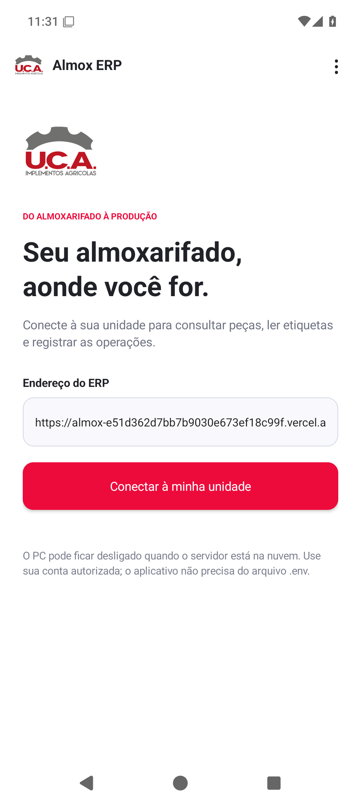

# Validação Android e ERP 2.7.0

## ERP

- `web-tests.log`: 216 testes passaram, sem falhas ou testes ignorados. Banco de testes isolado, sem dados ou credenciais da empresa.
- `typecheck.log`: `tsc --noEmit` concluiu com código 0.
- `build.log`: `prisma generate && next build` concluiu com código 0, incluindo `/login`, rotas autenticadas e API do assistente. Não aplica migrations.
- `vercel-check.json`: consulta HTTP pública do domínio fornecido. `/login` retorna 404; não houve validação do login ou PostgreSQL de produção.

Os testes de configuração incluem domínio canônico de produção na Vercel, prioridade de `APP_URL` explícita e separação das origens de preview. Esta versão acrescenta o cliente Android e a preparação de hospedagem; não altera as regras de movimentação, ordens ou conciliação.

## Android

O workflow manual **Aplicativo Android** compila as variantes release/debug, executa cinco testes de política de conexão, analisa o release com Android Lint e inspeciona o manifesto do APK efetivamente produzido. No emulador Android 15/API 35, os três testes instrumentados verificam:

1. Tela de conexão U.C.A. e recusa de um endereço HTTP antes de consultar a rede.
2. Bloqueio de arquivos locais, conteúdo misto e cookies de terceiros; integração nativa disponível apenas para a origem autorizada.
3. Abertura e encerramento de uma trilha de vídeo, sem microfone, em contexto HTTPS de teste.

O teste de câmera usa a câmera virtual do emulador. Não representa leitura de uma etiqueta física. A sessão web dos testes é fictícia e não tenta autenticação real no Supabase.

O instalador de distribuição é assinado fora do CI com a chave privada do projeto. A verificação final compara todos os arquivos internos do APK assinado com o APK sem assinatura produzido pelo runner; os bytes de código, recursos e manifesto precisam coincidir. O certificado público é versionado; o keystore e a senha não são enviados ao GitHub.

O relatório `VALIDACAO.json` do pacote de distribuição identifica o workflow, commit compilado, contagens finais de testes, SHA-256 e impressão do certificado. Os testes instrumentados usam a variante debug; a variante release recebe análise do manifesto e verificação criptográfica. Instalação no aparelho físico, login real, leitura de etiquetas, diálogos de exportação e impressão precisam ser homologados no dispositivo de destino e com o servidor disponível.

## Resultados finais

- [Compilação e testes Android aprovados](https://github.com/pedrowenz-a17y/almox/actions/runs/42719602197), commit compilado `619c1299892f291797351438db6dfffd84d26e17`: cinco testes de política e três instrumentados passaram. Lint: zero erros e nove avisos de versões mais recentes disponíveis. Os logs dos testes não registraram `WindowLeaked` ou falha fatal na thread principal.
- [Instalação do APK assinado aprovada](https://github.com/pedrowenz-a17y/almox/actions/runs/42720899419), candidato `9de45047d6a9cb2db2bdf35db81324af5db78107`: a ferramenta oficial `apksigner` verificou v2/v3 e o certificado esperado. O Android 15 aceitou o instalador, abriu a tela de conexão e reabriu o aplicativo após encerrá-lo. `installation-checks.json`, `first-open.xml`, `reopened.xml`, `signature.txt` e `almox-release.png` registram essa execução.
- APK final: **2.664.458 bytes**. Os **426 arquivos internos** coincidem byte a byte com o APK sem assinatura da compilação aprovada. SHA-256: `e2cfc744e8a49dc1cb950a9455e1884da1a65e4fb2ee1d33cc4a9762fb6a852d`.

