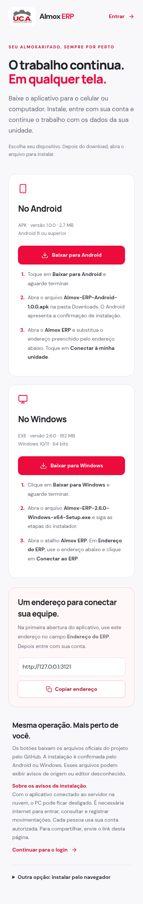

# Página de downloads · 2.7.2

`/instalar` oferece os arquivos nativos existentes: APK Android 1.0.0 e EXE Windows 2.6.0. Nenhum instalador foi recompilado, reassinado ou executado por esta revisão. Os avisos de origem/editor desconhecido continuam conforme as plataformas.

- `browser-checks.json`: dez verificações passaram no Chromium local, sem login nem dados reais. Foram conferidos links oficiais, downloads com resposta fictícia, nomes dos arquivos, layouts 1440/390/320 px, cópia da origem, alternativa quando clipboard é bloqueado, instalação web opcional, cache público e comportamento offline.
- `official-downloads.json`: requisições HEAD aos dois arquivos reais no GitHub retornaram HTTP 200 e tipo `application/octet-stream`, com os tamanhos esperados. O EXE informa `Content-Disposition: attachment`; o APK é entregue como binário, com nome na URL. O teste de download reproduz essas duas formas de resposta. Os arquivos completos não foram baixados novamente nesta revisão.
- `build.log`: compilação de produção concluída. TypeScript e ESLint também concluíram sem erros.
- `installability.json`: o perfil normal do Chromium continuou elegível à instalação web, que está na seção opcional da página.

Os testes exercitam a página e a interação com o navegador, sem instalar em um Android ou Windows físico. A pessoa precisa abrir o arquivo recebido e confirmar a instalação no sistema. O endereço mostrado é a origem da página atual, sem caminho, consulta ou credenciais, para copiar ao campo de conexão dos aplicativos.

As evidências de assinatura e instalação dos arquivos nativos permanecem em [Android 1.0.0](../android-1.0.0/README.md) e [revisão de segurança](../security-installation/README.md).

