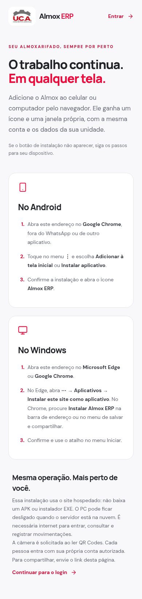

# Instalação e segurança · 2.7.1

Revisão do cliente web instalável e das informações de distribuição de APK/EXE. Não foram acessados dados da empresa nem utilizadas credenciais reais. Não houve análise antivírus, publicação em loja, aquisição de certificado ou nova assinatura dos arquivos nativos.

## Verificações

- `build.log`: compilação de produção concluída, incluindo `/instalar`, com `sharp` 0.35.5. A página utiliza a otimização de imagem do Next e os assets reais da U.C.A.
- `security-tests.log`: 12 testes de autenticação, proteção de origem, ocultação de credenciais/custos e diagnóstico sanitizado passaram pelo runner `tsx`.
- `browser-checks.json`: testes locais no Chromium de instalação, layouts 1440/390/320 px, consentimento/cancelamento/erro do instalador, cache público e comportamento offline. Eventos do diálogo de instalação são simulados; não são testes no sistema operacional Android/Windows físico.
- `installability.json`: o perfil normal do Chromium não reportou critérios de instalação pendentes. Um perfil anônimo não serve para essa conferência e foi excluído dessa etapa.
- `lock-check.log`: `npm ci --dry-run --ignore-scripts --no-audit --offline` concluiu sem conflito entre package.json e lockfile.
- `native-file-checks.json`: APK 1.0.0 com hash da entrega esperada, assinatura v2/v3 válida e certificado original; sem arquivos `.env` ou keystore no ZIP. O cabeçalho do EXE 2.6.0 não contém tabela Authenticode. Não se validou a cópia recebida no aparelho de terceiros.

`audit-web-production.json` registra zero vulnerabilidades conhecidas nas dependências npm de produção consultadas. `audit-web-all.json` mantém sete avisos moderados nas ferramentas TypeScript/ESLint; `audit-desktop-all.json`, seis na cadeia de empacotamento. Esses resultados não são uma certificação de segurança nem substituem acompanhamento de novos avisos.

O alerta alto do `sharp` anterior foi resolvido atualizando para 0.35.5. Nenhum `audit fix --force` foi usado; não se alterou a versão principal do empacotador desktop. Os instaladores anteriores continuam com os mesmos hashes e com as limitações de distribuição documentadas.

[Instalação e próximos passos para assinatura de editor](../../docs/INSTALACAO-E-ASSINATURA.md).
