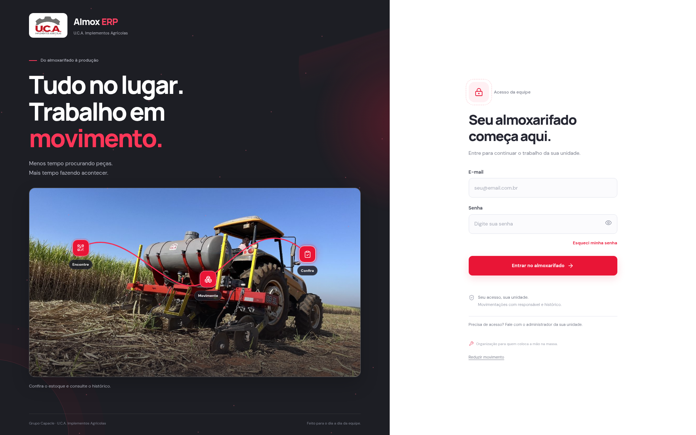

# Almox ERP 2.2.2 — menos sobreposições, movimento coordenado

A fotografia mantém apenas os três pontos **Encontre**, **Movimente** e **Confira**. O cartão flutuante, a etiqueta do canto, a faixa de varredura e a segunda fileira de botões foram retirados. Uma única legenda curta abaixo da foto acompanha a etapa.

A luz percorre a linha, deixa o trajeto vermelho e acende cada caixa ao chegar ao seu centro. As caixas já alcançadas permanecem vermelhas até o ciclo reiniciar. Linha, luz e caixas compartilham o mesmo progresso. Mouse, foco de teclado e toque permitem selecionar a etapa diretamente.

O controle destacado no alto do formulário foi substituído por **Reduzir movimento**, um link discreto no rodapé. Ele mostra uma composição estática: sem luz, trilha móvel, faixa congelada ou inclinação, com apenas a caixa selecionada em vermelho. **Ativar movimento** retoma o trajeto sem precisar clicar fora do controle. A preferência do navegador e a escolha salva continuam sendo respeitadas.

A alternância pausa durante o preenchimento do formulário e durante a seleção de uma caixa. O percurso também para quando a foto sai da tela ou a aba fica oculta. O título, a reação ao mouse e a fotografia grande continuam disponíveis.

[Ver prévia animada](../artifacts/welcome-2.2.2/abertura.gif)

Para atualizar, pare o servidor com **Ctrl+C**, extraia a nova versão e preserve seu `.env`. Na pasta atualizada, execute `npm ci`, `npm run build` e `npm start`.

Passaram 13 verificações de navegador, além da compilação, TypeScript e ESLint. As evidências estão em `artifacts/welcome-2.2.2/`. Os testes usam login e recuperação públicos, sem credenciais ou dados empresariais. A revisão é visual; não homologa a conexão real com o banco.
