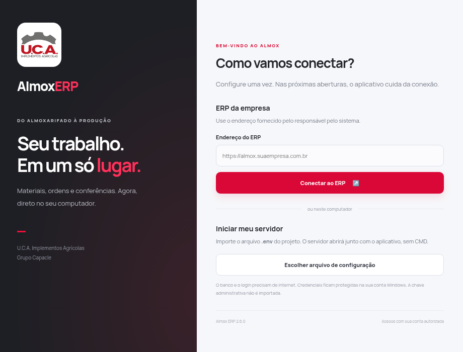

# Almox ERP para Windows — 2.6.0

O aplicativo tem instalador `.exe`, ícone U.C.A., atalhos na área de trabalho/menu Iniciar e janela própria. O computador que recebe o instalador não precisa instalar Node.js ou abrir CMD. O aplicativo inclui seu runtime e o servidor do ERP. Requer Windows 10/11 atualizado, arquitetura x64.

## Instalar e abrir

1. Baixe [Almox-ERP-2.6.0-Windows-x64-Setup.exe](https://github.com/pedrowenz-a17y/almox/releases/download/v2.6.0/Almox-ERP-2.6.0-Windows-x64-Setup.exe). O ZIP do código-fonte do GitHub não é o instalador.
2. Execute o instalador e escolha a pasta. A instalação é feita para a conta Windows atual.
3. Abra **Almox ERP** pelo atalho.
4. Na primeira abertura, escolha uma das conexões abaixo.

O instalador ainda não tem certificado de assinatura digital. A identidade do editor não é certificada pelo Windows. O SHA-256 está em [SHA256SUMS.txt](https://github.com/pedrowenz-a17y/almox/releases/download/v2.6.0/SHA256SUMS.txt). Esta entrega foi compilada, instalada, aberta, reaberta e desinstalada em um runner Windows. A configuração cifrada foi recuperada por DPAPI real, e os componentes nativos do Prisma/Sharp foram carregados. A homologação operacional no computador de destino continua necessária antes da distribuição empresarial.

## Usar neste computador, sem CMD

Clique em **Escolher arquivo de configuração** e selecione o `.env` do seu projeto. O aplicativo verifica o formato de `DATABASE_URL`, `DIRECT_URL`, `NEXT_PUBLIC_SUPABASE_URL` e `NEXT_PUBLIC_SUPABASE_PUBLISHABLE_KEY`. A senha do banco precisa estar corretamente codificada na URL copiada do Supabase.

O servidor inicia automaticamente, escuta somente em `127.0.0.1` e escolhe uma porta livre. `APP_URL` e as origens permitidas são definidos para essa instância; não é necessário alternar manualmente entre localhost, 127.0.0.1, 3000 ou 3010. Fechar a janela principal encerra o servidor. Uma segunda abertura pelo atalho traz o aplicativo existente para a frente.

O `.env` original não é copiado para a instalação. As variáveis permitidas são salvas cifradas pela proteção da conta Windows (DPAPI), em `connection.json` dentro de `%APPDATA%\Almox ERP`. O app não importa a chave administrativa Supabase, variáveis de provisionamento ou comandos de inicialização do Node. A criptografia protege o arquivo em repouso; o processo do servidor e o usuário autorizado do computador têm acesso às credenciais em uso.

O assistente continua gratuito por padrão. A chave OpenAI só é importada se o arquivo escolher explicitamente `ASSISTANT_PROVIDER="openai"`.

Login, imagens, relatórios e operações continuam usando PostgreSQL e Supabase Auth. O aplicativo não instala um PostgreSQL local, não cria contas, não executa migrations e não corrige uma senha ou um bloqueio de rede. A base precisa estar configurada e atualizada conforme o [guia operacional](CONTROLE-OPERACIONAL-2.4.md). Depois, use a conta já autorizada da unidade.

Para recuperar senha por e-mail no modo local, o administrador precisa configurar redirecionamentos de loopback no Supabase. Como a porta é escolhida ao abrir, o link precisa apontar para a instalação ativa. Para uso empresarial e links de recuperação permanentes, prefira a conexão HTTPS hospedada.

## Conectar ao ERP da empresa

Informe a origem HTTPS completa, por exemplo `https://almox.suaempresa.com.br`, sem `/login`. O aplicativo abre a instalação hospedada. Nesse modo, cada funcionário precisa apenas do endereço e de sua conta de acesso; as credenciais do banco ficam no servidor da empresa.

HTTP é aceito somente em loopback, para conectar a uma instalação neste mesmo computador. Um endereço de outro computador da rede deve usar HTTPS. A hospedagem não é criada pelo instalador; o servidor remoto precisa estar disponível.

## Câmera, impressão e conexão

O ERP abre com isolamento de contexto, sandbox e sem acesso Node.js na página. A câmera exige permissão e fica limitada à origem configurada; o microfone não é liberado. A leitura de QR depende também das permissões de câmera do Windows. Downloads abrem uma janela para salvar. Etiquetas e relatórios usam a impressão do sistema.

Use **Arquivo → Configurar conexão** para trocar o endereço ou importar novamente a configuração. **Exibir** permite recarregar, ajustar zoom e entrar em tela cheia. Não é necessário reinstalar para corrigir a conexão.

O perfil de conexão é preservado entre atualizações e desinstalações. Em computador compartilhado ou antes de transferi-lo, remova o perfil de `%APPDATA%\Almox ERP` após encerrar o aplicativo. As conversas do assistente não são gravadas pelo chat no banco; o perfil do navegador pode guardar a sessão de login e preferências.

## Gerar um novo instalador, para desenvolvimento

Na raiz do projeto, com Node.js 24 e npm:

```cmd
npm ci
npm run desktop:install
npm run desktop:dist
```

O arquivo final fica em `desktop/dist`. `npm run desktop:dist` compila com valores fictícios, prepara o servidor e gera os binários Prisma/Sharp para Windows. Arquivos `.env` são excluídos. As dependências desktop têm lockfile separado para manter o pacote web independente do Electron. Atualizações de Electron, Prisma, Sharp e electron-builder precisam de uma nova compilação e validação; não há atualização automática no aplicativo.

Verificações:

```cmd
npm run desktop:test
node desktop/scripts/verify-package.cjs
node desktop/tests/verify-electron.cjs
```

O último comando precisa do build de produção e de uma sessão gráfica. No Linux, usa Xvfb; no Windows, usa a sessão gráfica e a DPAPI reais. A extração Unix do desinstalador utiliza o leitor oficial PE/NSIS do electron-builder 26.18.0, sem executar o instalador intermediário. A dependência está fixada e o adaptador precisa ser revisado se essa versão mudar.

## Validar e publicar pelo GitHub

Em **Actions → Instalador Windows → Run workflow**, a rotina manual compila em Windows, executa os testes e instala o aplicativo em uma máquina descartável. Ela confere o servidor embutido, as bibliotecas nativas, a configuração por DPAPI, a reabertura e a desinstalação. O teste de instalação só executa nesse runner para proteger computadores de desenvolvimento.

A compilação tem acesso de leitura ao repositório. Apenas o job final pode criar a release e enviar os anexos, após o sucesso dos testes. Não recebe credenciais do banco ou da empresa e não faz deploy do ERP. As actions oficiais são fixadas por revisão; a publicação utiliza o GitHub CLI. Uma versão já publicada não é sobrescrita: para outra entrega, atualize a versão e acrescente suas notas em `docs/ENTREGA-WINDOWS-<versão>.md`.

## Evidências desta entrega

Veja [artifacts/desktop-2.6.0/windows](../artifacts/desktop-2.6.0/windows): dez cenários da janela, seis verificações do aplicativo instalado e comparação por hash de 2.236 arquivos do servidor. A [execução Windows](https://github.com/pedrowenz-a17y/almox/actions/runs/42442820123) concluiu os testes e a publicação. A pasta acima mantém também a regressão inicial do ERP em PostgreSQL isolado e as evidências da compilação Linux. Nenhuma credencial enviada no chat ou banco empresarial foi utilizado na validação.


