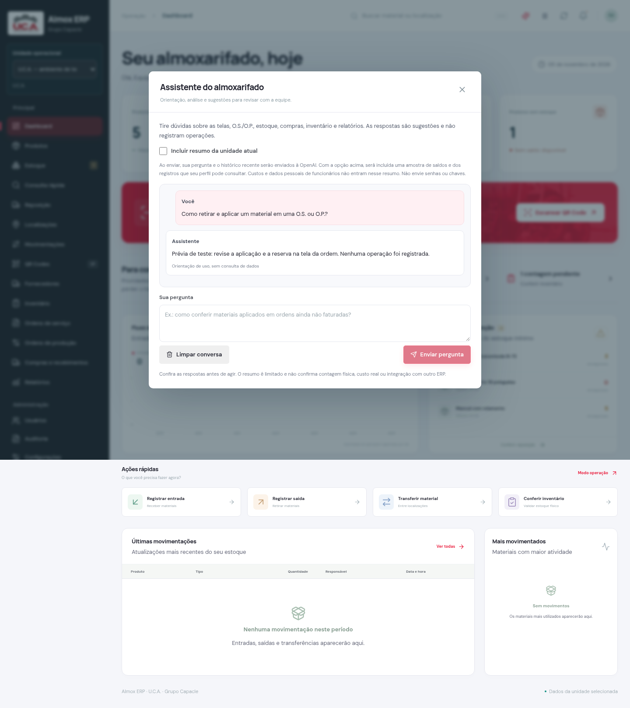

# Assistente OpenAI — Almox ERP 2.3

O botão **Assistente IA** na barra superior das telas internas abre uma conversa para orientação nos módulos do aplicativo: produtos, QR Codes, localizações, movimentações, reposição, compras, inventário, O.S./O.P., relatórios e configuração. A IA apresenta análises e sugestões; salvar operações continua sendo uma ação explícita nas telas do ERP.

## Configurar no servidor

No `.env` da pasta do projeto:

```env
OPENAI_API_KEY="sua_chave_da_API"
OPENAI_MODEL="gpt-4.1-mini"
```

Use uma chave do projeto da OpenAI com acesso à API Responses e ao modelo escolhido. Configure e acompanhe orçamento/alertas no painel da API. A API tem cobrança própria; uma assinatura do ChatGPT não fornece automaticamente créditos de API. Não coloque a chave em variáveis `NEXT_PUBLIC_`, campos do navegador, repositório ou mensagens do chat.

Pare o servidor com **Ctrl+C**. Para instalar esta versão em uma pasta nova, preserve seu `.env` e execute:

```bat
npm ci
npm run build
npm start
```

Depois de alterar somente `OPENAI_API_KEY` ou `OPENAI_MODEL`, reinicie `npm start`. A integração usa `fetch` do Node e a API Responses oficial, sem instalar dependência adicional. A falta da chave desabilita as consultas de IA com uma mensagem orientativa, sem impedir os demais módulos. Login e conexão PostgreSQL precisam funcionar para acessar o assistente autenticado; a OpenAI não substitui o Supabase.

## Usar

Abra o assistente, escolha uma sugestão ou escreva uma pergunta. **Enviar pergunta** inicia a chamada; abrir a janela ou visitar uma página não consome chamadas de IA.

Sem marcar **Incluir resumo da unidade atual**, são enviados somente a pergunta, até quatro mensagens recentes e as instruções de uso do aplicativo. O histórico pode conter informações mencionadas em respostas anteriores.

Ao marcar a opção, o servidor consulta a unidade autenticada e prepara um resumo: até 30 produtos ativos em ordem de código, seus saldos/compromissos, até 15 ordens abertas mais antigas com até 15 materiais cada, contagens por situação e número de compras abertas. Ordens, compras e inventários respeitam as permissões do perfil. O resumo exclui custos, documentos de fornecedores, observações livres e identificação dos funcionários. Ele representa os registros do aplicativo, não uma conferência física nem a integração com o ERP oficial.

Perguntas úteis:

- Como aplicar um material na O.P. sem duplicar a baixa no faturamento?
- Quais pendências aparecem nesta amostra de ordens abertas?
- Qual a diferença entre saldo contábil, físico esperado e disponível?
- Como preparar um pedido pela reposição e revisar antes de salvar?
- Como planejar uma contagem periódica e investigar diferenças?
- Como usar as etiquetas, consultas e relatórios do aplicativo?



## Limites e privacidade

O histórico fica somente na memória da interface, com até 20 mensagens; o envio usa as quatro mais recentes, com trechos limitados. **Limpar conversa**, recarregar ou trocar usuário/unidade/permissões elimina o histórico da interface. Trocar a unidade ou fechar a janela cancela a requisição pendente. A conversa não é salva no banco do aplicativo. Chamadas já iniciadas no provedor ainda podem ser cobradas mesmo que a janela seja fechada.

A requisição usa `store: false` na OpenAI. Isso não equivale a uma garantia de retenção zero: o tratamento no provedor segue as políticas e configurações da conta da API. A interface informa o envio antes de cada consulta e permite escolher a inclusão do resumo. Não digite credenciais ou dados pessoais nas perguntas.

Cada resposta tem limite de 1.200 tokens de saída e tempo de 25 segundos para a requisição ao provedor. Há limite local de cinco requisições por minuto por usuário/unidade, por processo. Em uma implantação com múltiplas instâncias, esse limite não é global; orçamento e monitoramento da API continuam necessários.

O assistente não recebe ferramentas, SQL, credenciais ou permissão de escrita no estoque. A IA pode errar: uma recomendação deve ser conferida nos registros e procedimentos da empresa. Ela não deve ser usada para fabricar resultados do TCC, afirmar custos reais sem dados ou executar faturamentos e ajustes automaticamente.

## Validação

Passaram 17 testes de serviço, nove verificações de interface e quatro verificações HTTP de proteção do endpoint. Compilação, TypeScript e ESLint também passaram. Os testes de serviço usam respostas simuladas para verificar permissões, isolamento de unidade, limites, exclusão de segredos e mensagens de erro. O laboratório de interface usa os componentes reais com dados/API fictícios. Sem chave fornecida, não houve chamada real ou gasto de créditos OpenAI; a integração com uma conta real precisa ser conferida após a configuração.

Evidências em `artifacts/assistant-2.3.0/`.
