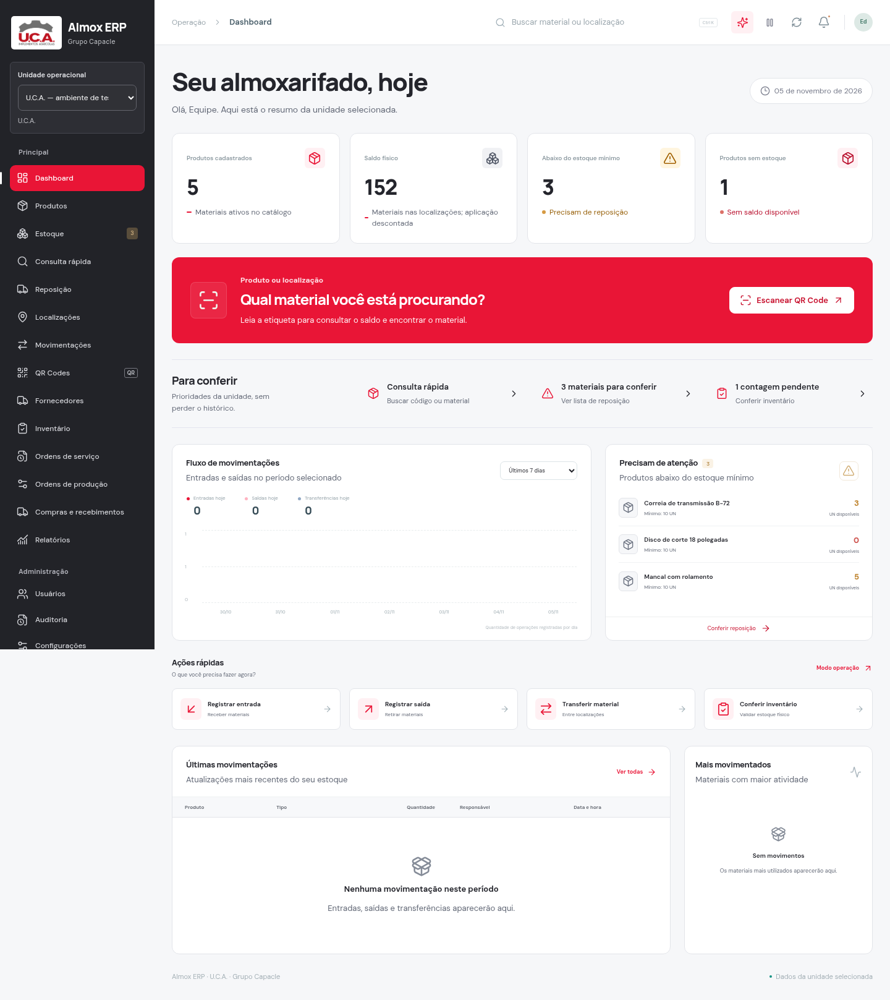
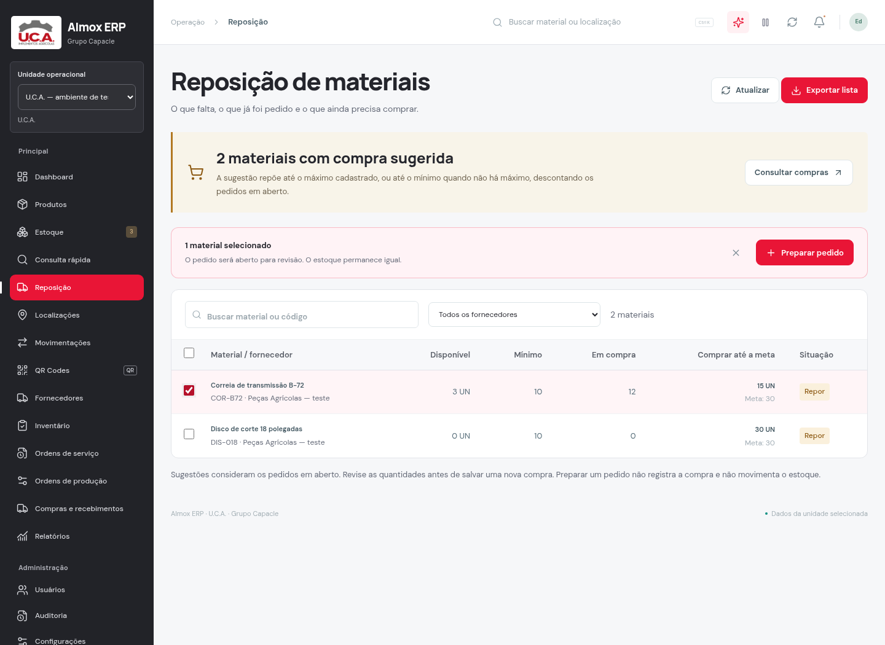
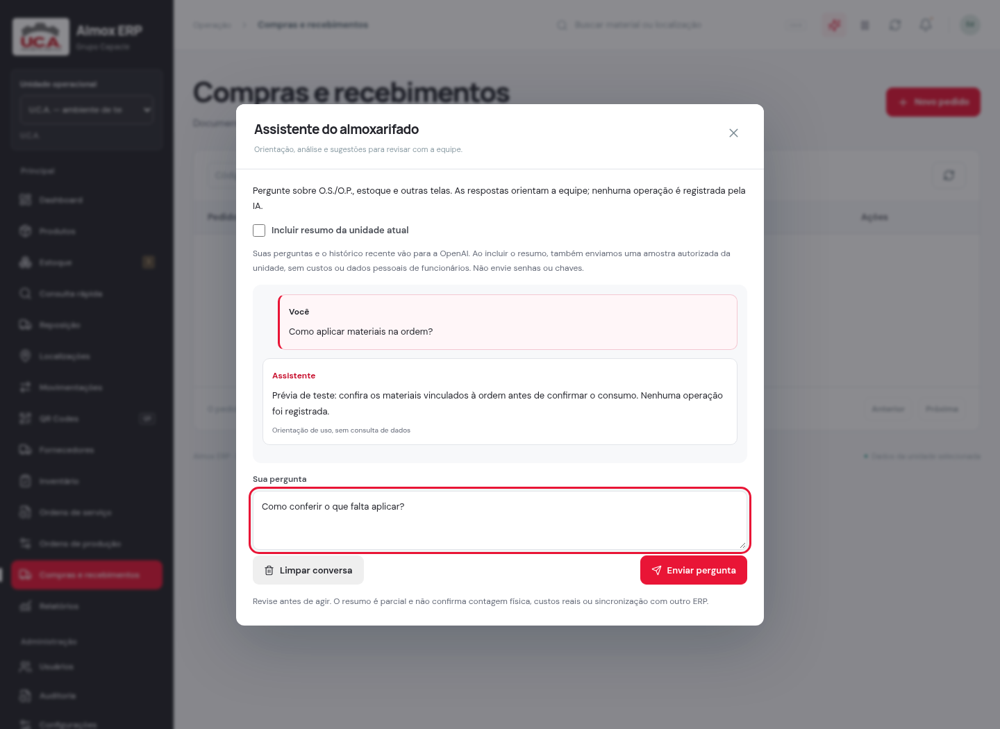

# Identidade U.C.A. — versão 2.3.1

As telas de trabalho acompanham a entrada: vermelho vivo da U.C.A., tipografia local Manrope/DM Sans, fundo claro e texto escuro. A marca oficial foi preservada.

| Uso | Cor |
| --- | --- |
| Ações principais e menu selecionado | `#e91536` |
| Variação para interação e links | `#c70d2b` |
| Realce leve | `#fff0f3` |
| Navegação lateral | `#222328` |
| Fundo de trabalho | `#f6f7f9` |
| Texto principal | `#24252c` |
| Texto secundário | `#626876` |

O vermelho se concentra nas ações e nos pontos de orientação. Tabelas, cartões e formulários mantêm superfícies neutras. Verde e amarelo continuam indicando aprovação e atenção quando fazem sentido para o estado do registro.

Foram retirados o vinho do menu ativo, os tons esverdeados de ícones decorativos e parte dos brilhos e sombras. O destaque de QR do painel ficou sólido, sem imagem e reflexo sobrepostos. A entrada mantém a fotografia e o percurso simplificado da revisão anterior.

A janela da IA ganhou cores consistentes, textos mais curtos e melhor contraste. As janelas de formulário passaram a ser renderizadas sobre a página inteira para não serem cortadas pelos contêineres e animações da área de trabalho. A navegação por teclado, fechamento e retorno do foco foram preservados.

## Prévias

As capturas usam componentes reais com dados e respostas de IA fictícios em um laboratório separado.

## Atualização

Preserve seu `.env`, pare o servidor com **Ctrl+C** e execute `npm ci`, `npm run build` e `npm start` na pasta atualizada. As configurações de banco e OpenAI continuam no servidor.

Passaram 19 verificações de interface, além de compilação, TypeScript e ESLint. Evidências em `artifacts/identity-2.3.1/`. Não houve uso de chave real da OpenAI nem consulta a dados empresariais nesses testes.
