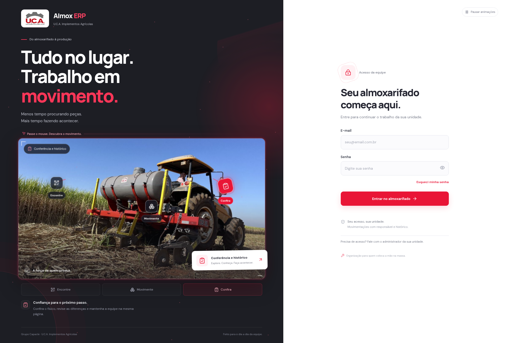

# Almox ERP 2.2 — uma abertura para explorar

A tela inicial agora reage ao movimento do mouse. A fotografia grande da U.C.A. foi mantida e ganhou uma apresentação dos recursos do almoxarifado que pode ser explorada sem entrar na conta.

- A luz e um halo acompanham o cursor; as partículas próximas se afastam e criam conexões. Clicar no painel produz uma onda com pequenos fragmentos.
- A foto inclina em 3D e ganha profundidade ao mover o mouse. O cartão acompanha o movimento em outra velocidade.
- Os pontos **Encontre**, **Movimente** e **Confira** mudam a apresentação ao receber o mouse, foco de teclado ou toque. A foto mostra varredura, uma rota animada e destaque do recurso selecionado.
- As letras do título respondem individualmente ao mouse, com deformação elástica. Os botões dos recursos e de acesso acompanham levemente o cursor.
- No celular, a foto também aparece e os pontos funcionam por toque. O link **Ir para o acesso** leva diretamente ao formulário.

[Ver a prévia animada](../artifacts/refresh/abertura-animada.gif)



## Movimento e desempenho

O botão **Pausar animações** interrompe os efeitos CSS, o desenho das partículas e os eventos que acompanham o mouse. Sem escolha salva, a preferência de movimento reduzido do dispositivo é respeitada; a pessoa pode ativar os efeitos explicitamente e essa escolha fica salva no navegador. Os recursos continuam selecionáveis com as animações pausadas.

O desenho usa um único canvas, com 38 partículas, resolução limitada e no máximo 30 redesenhos por segundo. Ele para quando a aba fica oculta ou o painel sai da área visível. Os eventos de mouse são agrupados por quadro, sem atualizar o estado React a cada movimento. Não foi acrescentada dependência de animação, serviço externo ou consulta ao banco para produzir efeitos.

O formulário fica disponível desde o início. A troca automática dos destaques pausa durante a exploração, o foco nos recursos e o preenchimento do acesso. Os efeitos apresentam funcionalidades; não representam saldos ou operações reais.

## Atualizar no computador

Baixe o ZIP desta versão e extraia em uma pasta nova. Pare o servidor antigo com **Ctrl+C**, preserve seu `.env` e copie-o para a pasta atualizada. No CMD dessa pasta:

```bat
npm ci
npm run build
npm start
```

Abra a URL indicada no terminal. Para desenvolver, use `npm run dev`. Se ainda vir a tela anterior, confira se o CMD está na pasta atualizada e recarregue a página com **Ctrl+F5**.

A versão 2.2 não altera banco, migrations ou regras de autenticação. Problemas de conexão PostgreSQL continuam sendo diagnosticados com `npm run doctor`.

## Conferência

A compilação de produção, o TypeScript e o ESLint foram executados. Passaram 13 verificações das novas interações e 12 dos fluxos públicos, totalizando 25 verificações de navegador. As evidências de interação em navegador estão em `artifacts/refresh/interaction-checks.json`; a revisão dos fluxos públicos e tamanhos de tela está em `artifacts/refresh/welcome-checks.json`. Os testes usam a aplicação compilada, sem credenciais empresariais, e verificam mouse, teclado, toque, pausa e acesso ao formulário.

Uma amostra de custo de tarefas e requisições está em `artifacts/refresh/interaction-performance.json`. Ela registra também as tarefas longas observadas no Chromium headless local e não garante desempenho em outro computador.

As evidências de banco e painel das versões anteriores continuam no diretório; não são uma nova homologação de produção desta alteração visual.
