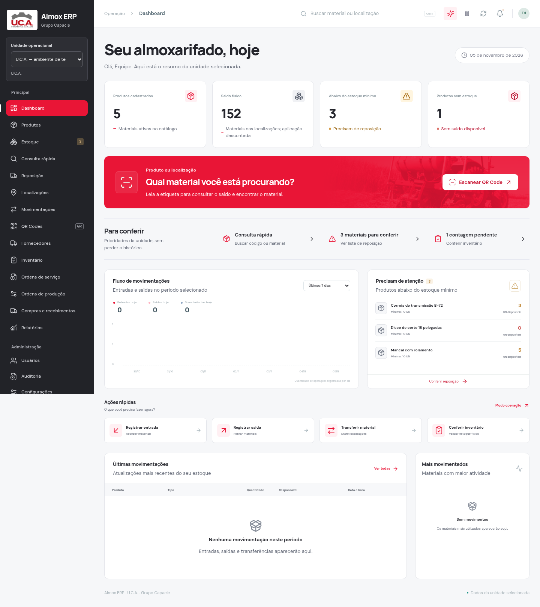

# Painel U.C.A. — fotografia e movimento leve

A foto oficial do implemento voltou ao retângulo vermelho do painel, com transparência e uma transição suave para o fundo. O vermelho vivo e a composição clara da versão anterior foram mantidos.

Os cartões entram em sequência e o destaque aparece suavemente. A imagem de fundo tem aproximação lenta, sem movimentar o texto ou o botão. No mouse, um reflexo passa uma vez pelo banner e o ícone responde de forma discreta. Não há partículas ou conteúdo adicional nas telas operacionais.

O modo de movimento reduzido mantém a foto estática e esconde o reflexo. A preferência do dispositivo, o controle do aplicativo e a pausa das animações quando a aba fica oculta continuam sendo respeitados.

[Ver prévia animada](../artifacts/dashboard-2.3.2/painel.gif)

Passaram nove verificações de navegador, além de compilação, TypeScript e ESLint. As capturas usam os componentes reais com dados fictícios em laboratório separado. Evidências de compilação, TypeScript, ESLint e revisão de navegador estão em `artifacts/dashboard-2.3.2/`.

Para atualizar, preserve seu `.env`, pare o servidor com **Ctrl+C** e execute `npm ci`, `npm run build` e `npm start` na pasta atualizada.
