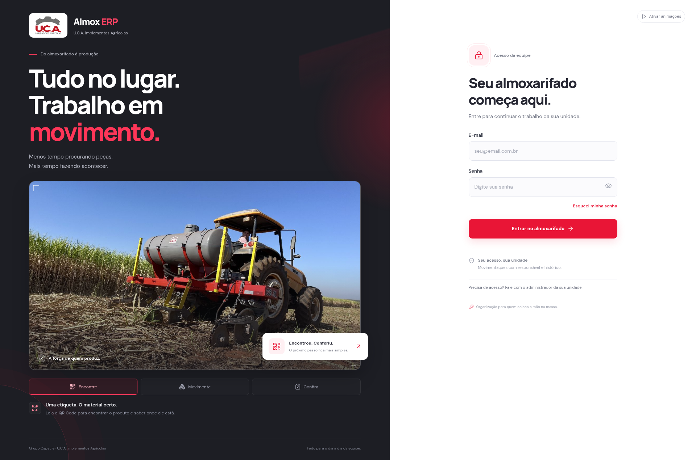
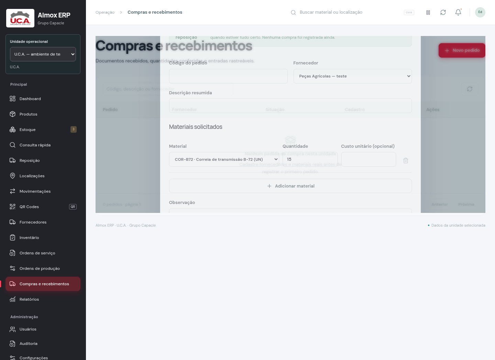

# Almox ERP U.C.A. 2.1 — visual, movimento e compras assistidas

Revisão de 5 de novembro de 2026. Foram comparados os dois ZIPs enviados pelo usuário: a versão anterior de referência e o `almox-main.zip`. A base funcional mais recente foi preservada. O `.env` local encontrado na versão de referência não foi copiado para o repositório ou para o pacote de distribuição.

## Correção 2.1.1

A fotografia ocupa toda a largura útil do painel esquerdo e chega a 520 px de altura em desktop, substituindo o limite anterior de 680 px de largura e 265 px de altura. O formulário acompanha a rolagem em telas grandes. A aproximação suave da foto foi ampliada, e o botão de animações agora aceita a escolha explícita do usuário mesmo quando o Windows prefere movimento reduzido.

## O visual desta revisão

O vermelho escurecido e a fonte condensada da revisão anterior foram substituídos. A cor principal agora é `#e91536`, mais viva, com contraste de aproximadamente 4,54:1 para texto branco. Os títulos usam Manrope e o texto usa DM Sans, em arquivos WOFF2 locais; as licenças acompanham o projeto. Nenhuma fonte é buscada no Google durante o uso do ERP.

A tela de entrada ganhou apresentação animada dos títulos, luz ambiente, profundidade suave na fotografia oficial U.C.A., cartão flutuante, reflexo na foto e destaques de recursos. Os botões **Encontre**, **Movimente** e **Confira** podem ser selecionados; quando o formulário não está sendo usado, eles alternam a cada 6,5 segundos. Isso apresenta os recursos sem inventar saldos, pedidos ou indicadores empresariais.

O formulário permanece disponível desde a abertura, sem intro bloqueante ou tempo de espera artificial. Ao preencher o acesso, a rotação dos destaques pausa; o movimento suave da fotografia, luz e cartão continua quando as animações estão ativadas. O controle **Pausar animações** funciona no login e no painel e preserva a preferência no navegador. Sem escolha salva, a preferência de movimento reduzido do dispositivo é respeitada. O botão **Ativar animações** permite escolher explicitamente o movimento, mesmo nesse dispositivo; essa escolha fica salva no navegador. As animações também pausam quando a aba está oculta.

O painel acompanha a mesma identidade: vermelho vivo, títulos sem condensação, cartões separados, resposta dos botões, entrada das telas e movimento dos gráficos. As melhorias anteriores de navegação persistente, QR por produto, consulta rápida e reposição foram mantidas.

[Ver prévia animada da abertura](../artifacts/refresh/abertura-animada.gif)



## Funções acrescentadas

### Da reposição para um pedido revisável

Na tela **Reposição**, usuários com `purchases:write` podem selecionar materiais com sugestão positiva e fornecedor ativo e clicar em **Preparar pedido**. O formulário de compra abre com fornecedor, materiais e quantidades preenchidos. A pessoa informa o código do pedido, revisa os itens e confirma **Salvar pedido**.

Preparar não salva uma compra nem movimenta estoque. Custos não são copiados ou inventados. As quantidades decimais são preservadas como texto, sem arredondamento no preenchimento. Não é permitido misturar fornecedores, selecionar fornecedor inativo ou preparar mais de 200 materiais em um pedido. A seleção é da unidade atual; a troca de unidade descarta o preenchimento em memória.

A API de compras continua validando identidade, unidade, permissões, fornecedor, produtos, quantidades e idempotência ao salvar. O preenchimento de interface não substitui essa autorização. Uma quantidade sugerida pode mudar com novas operações de outros usuários, por isso continua exigindo revisão.



### Diagnóstico local do ambiente

O novo comando ajuda a resolver erros de configuração e conexão sem alterar dados:

```bash
npm run doctor
```

Ele verifica formato das variáveis, separação de chave pública/administrativa, conexão com PostgreSQL, presença de tabelas essenciais, existência de vínculo ativo de acesso e resposta do serviço Supabase Auth. Os resultados são **OK**, **AVISO** ou **FALHA**, com instruções específicas. Valores de chaves, senhas, URLs de conexão e mensagens brutas do provedor não são exibidos.

Para conferir somente o formato, sem consultar banco ou Auth:

```bash
npm run doctor -- --offline
```

Também há `--json` para saída estruturada e `--production` para exigir origens HTTPS. O diagnóstico não tenta login, não redefine senhas, não envia convites, não executa migrations e não escreve no banco. Um resultado de configuração correta não comprova que uma conta específica consegue entrar.

## O que recomendo acrescentar ao ERP depois

| Prioridade | Recurso | Ganho para a empresa | O que definir antes |
| --- | --- | --- | --- |
| Alta | Aprovação de compras e cotações por fornecedor | Separar quem pede, quem aprova e quem recebe; comparar propostas | Limites de aprovação, responsáveis e tratamento de compras urgentes |
| Alta | Importação de materiais por planilha com prévia | Reduzir digitação e erros ao iniciar o catálogo | Colunas, duplicidade de códigos, unidades e autorização; nunca importar saldo sem movimento auditado |
| Alta | Documentos anexados a compras e recebimentos | Guardar a evidência junto ao pedido, além da referência textual atual | Tipos/tamanhos de arquivo, retenção, acesso por unidade e armazenamento |
| Média | Cliente, equipamento e identificação técnica vinculados à O.S. | Localizar o histórico de materiais usados em cada atendimento | Cadastros reais e se a O.S. atende cliente externo, frota interna ou ambos |
| Média | Estrutura de materiais e etapas para O.P. | Planejar necessidades e acompanhar a execução da produção | Lista técnica, versões, perdas, conversões e responsáveis por etapa |
| Média | Inventário cíclico e classificação ABC | Direcionar conferência para itens críticos e reduzir divergências | Critério de criticidade, periodicidade e processo de aprovação |
| Dependente de integração | Fiscal e financeiro | Ligar consumo e compras a documentos e pagamentos | Regras contábeis/fiscais, provedor e homologação com os responsáveis |

Estas linhas são recomendações, não funções declaradas como implementadas. A versão atual continua focada em almoxarifado, compras e materiais de ordens. Não há emissão de NF-e, financeiro completo, produção com roteiro industrial ou movimentação offline.

## Atualização local

Mantenha seu `.env` protegido e preserve o banco existente. Esta revisão não altera o schema Prisma nem acrescenta migrations. Na pasta do projeto atualizado:

```bash
npm ci
npm run doctor
npm run build
npm start
```

`doctor` pode retornar falha enquanto a configuração do Supabase não estiver concluída. Siga os itens indicados e o README para provisionar o acesso real. O modo de desenvolvimento continua disponível com `npm run dev`; sua primeira compilação é mais lenta que a execução do build de produção.

Foi configurada a permissão de desenvolvimento para os hosts locais `localhost` e `127.0.0.1`, conforme o contrato desta versão do Next.js. Isso não altera a proteção de origem das APIs, não libera outros domínios e não substitui `APP_URL`/`APP_ALLOWED_ORIGINS`.

## Validação e alcance

As evidências desta revisão estão em `artifacts/refresh/`:

- Suíte de regras e integração com PostgreSQL isolado e engine nativa oficial do Prisma: **96 testes aprovados, sem falhas nem skips**.
- Compilação normal com `npm run build`, TypeScript e ESLint.
- **12 verificações aprovadas** de login e recuperação públicos na aplicação real compilada: fontes locais, interações, pausa persistente, movimento reduzido, tamanhos de 320 a 1920 px e proteção das telas privadas.
- **12 verificações aprovadas** de fluxos do painel em laboratório separado com os componentes reais e respostas de API fictícias: navegação, QR, cadastro, reposição, preparação e confirmação explícita da compra e comportamento em celular.
- `doctor` exercitado com PostgreSQL real isolado e um respondedor local de configuração Auth. Esse respondedor não foi incluído na aplicação.

O projeto Supabase da empresa, o login com contas reais, o e-mail, a câmera e a impressora físicos não foram homologados nesta revisão. Nenhum banco empresarial, site ou ambiente foi publicado/alterado por esses testes. O resultado do laboratório de interface não é evidência de autenticação de produção.
